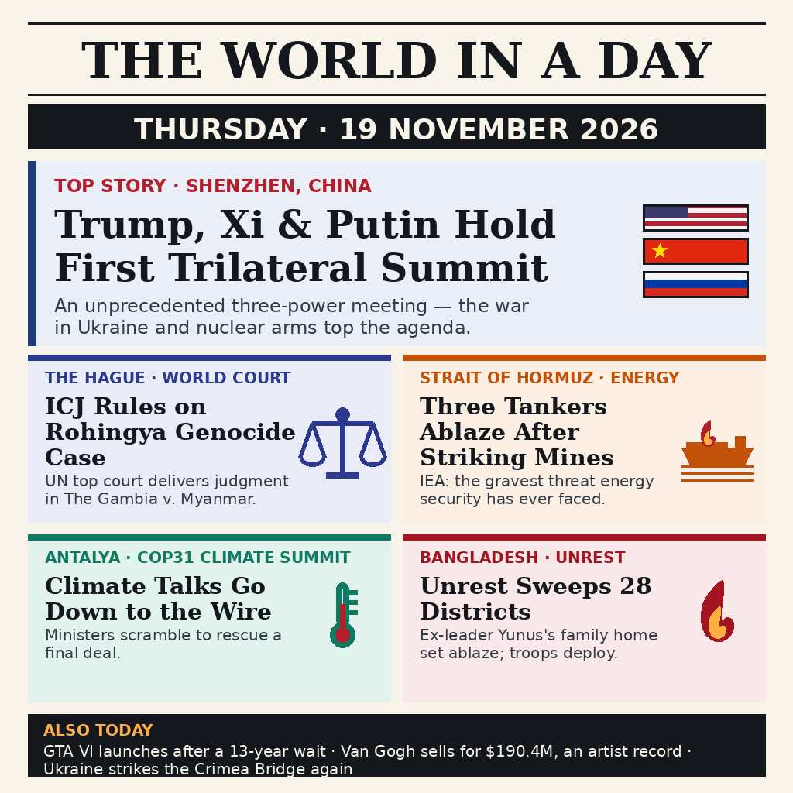

# The World in a Day — 19 November 2026 in one image

[](https://make.fun/bounty/news-image-20261119?utm_source=github&utm_medium=readme&utm_campaign=news-image-20261119)
[](https://make.fun/bounty/news-image-20261119/leaderboard?utm_source=github&utm_medium=readme&utm_campaign=news-image-20261119)
[](https://make.fun/bounty/news-image-20261119?utm_source=github&utm_medium=readme&utm_campaign=news-image-20261119)

My entry to make.fun's **news-image-20261119** bounty: one 1024×1024 image
that sums up the world news of **Thursday 19 November 2026** — a broadsheet
front page drawn entirely in code, no photographs, no external assets.

Competing on make.fun yourself? Sign up through my referral link —
https://make.fun/r/1c94brae (referral code `1c94brae`).

## The picture



The day's five biggest stories, plus a ticker of three more:

- **Top story — Shenzhen, China.** Trump, Xi & Putin hold the first-ever
  trilateral summit; the war in Ukraine and nuclear arms top the agenda.
- **The Hague.** The International Court of Justice rules on the Rohingya
  genocide case, The Gambia v. Myanmar.
- **Strait of Hormuz.** Three oil tankers ablaze after striking mines; the
  IEA calls the crisis the gravest threat energy security has ever faced.
- **Antalya.** COP31 climate talks go down to the wire as ministers
  scramble to rescue a final deal.
- **Bangladesh.** Unrest sweeps 28 districts; ex-leader Yunus's family
  home is set ablaze and troops deploy.
- **Also today:** GTA VI launches after a 13-year wait · a Van Gogh sells
  for $190.4M, an artist record · Ukraine strikes the Crimea Bridge again.

## Run it

```sh
python3 main.py                          # writes /output/entry.png
MAKEFUN_OUTPUT_DIR=out python3 main.py   # or anywhere else
```

`main.py` is Python 3 standard library only. It checks that `entry.png`
is a whole PNG inside the competition's gate limits (at most 1 MiB,
at most 1024×1024) and then copies it, byte for byte, to the output
directory — so every run writes identical bytes, offline.

## How the image was made

`build_image.py` draws the poster with PIL: masthead, date bar, the hero
panel with three stylised flags (US, China, Russia), and four story
panels with hand-drawn icons — scales of justice, a burning tanker, a
thermometer, a flame. It is kept in the repo as the picture's source;
the entry itself only needs `main.py` and `entry.png`.

## License

MIT — see `LICENSE`.
